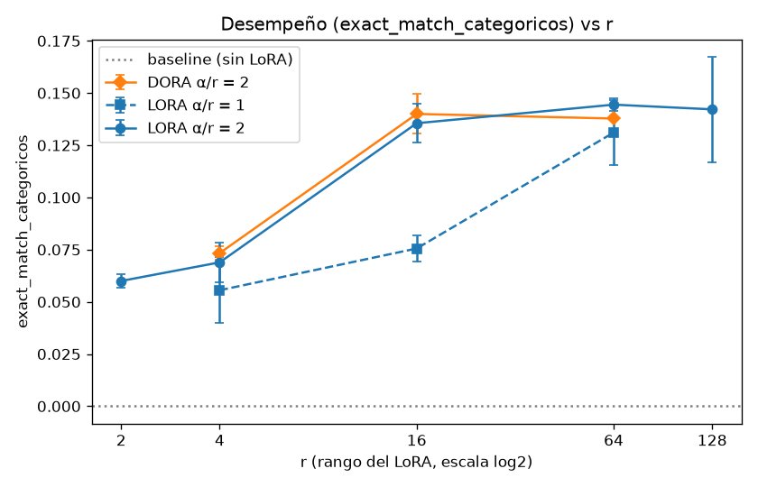
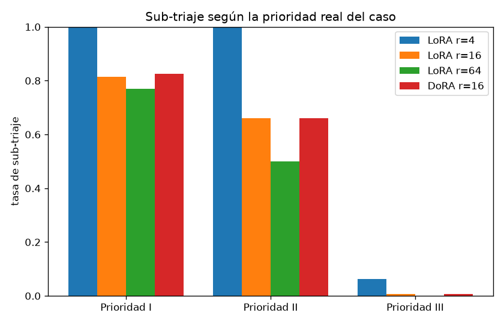
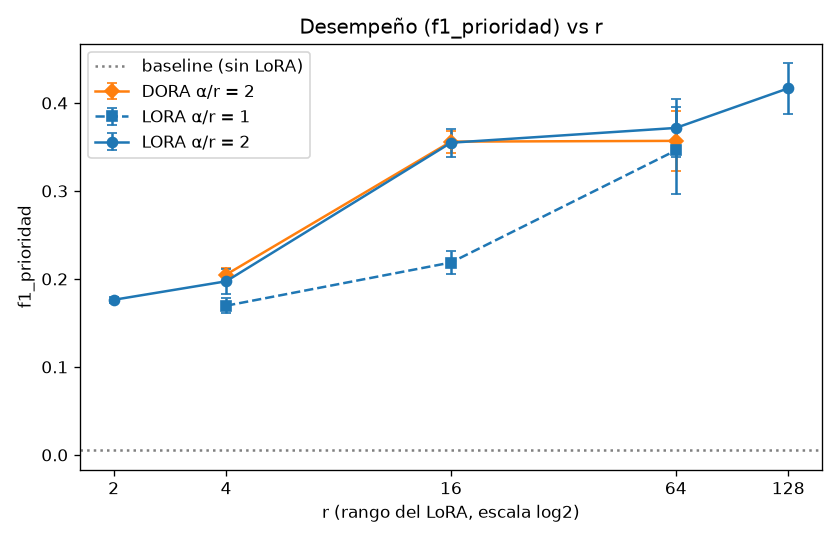

# Triaje clínico con LoRA — Hackatón 8 (equipo Las Grills)

Refinamiento de un LLM con **LoRA** (y comparación contra **DoRA**) para una tarea
de **triaje clínico**: a partir de un mensaje libre de un paciente o familiar a una
clínica en Perú, el modelo produce un objeto **JSON** estructurado con la
especialidad, prioridad, acción, grupo de edad, signos de alarma, síntomas y un
resumen.

Curso UTEC — docente Robert Buleje.

## Esquema de salida

```json
{
  "especialidad": "medicina_general | pediatria | ... | administrativo",
  "prioridad": "I | II | III | IV",
  "accion": "emergencia_inmediata | atencion_mismo_dia | cita_programada | orientacion_remota | gestion_administrativa",
  "grupo_edad": "lactante | nino | adolescente | adulto | adulto_mayor | no_especificado",
  "signos_alarma": true,
  "sintomas": ["lista", "de", "sintomas", "normalizados"],
  "resumen": "resumen clínico de 5 a 25 palabras"
}
```

La **prioridad** sigue la NTS N° 042-MINSA/DGSP-V.01 (4 niveles). Las clases y la
validación viven en un único lugar: [`src/triaje/schema.py`](src/triaje/schema.py).
Los criterios de etiquetado con ejemplos están en
[`data/guia_etiquetado.md`](data/guia_etiquetado.md).

## Modelo y hardware

- **Modelo base:** `Qwen/Qwen2.5-0.5B-Instruct` (0.5B, multilingüe), en **fp16** sin
  cuantizar: cabe entero en la T4. Lo elegimos en lugar de Phi-3.5-mini (3.8B, 4-bit)
  para que el diseño experimental completo corra en ~1-2 h de GPU.
- **Hardware:** Google Colab **T4 (16 GB)**, la misma GPU para todos los experimentos.
- Ajustes T4: `fp16` (no hay bf16), `attn_implementation="sdpa"` (no hay
  flash-attention 2), `adamw_torch`.

## Diseño experimental

23 corridas (ver `src/triaje/experimentos.py`), con una semilla por ronda (42 y 123).
Todo lo demás queda fijo: modelo, datos, 100 pasos, batch efectivo 16, lr 2e-4 y GPU.

| Fase | r | α/r | Técnica | Semillas | Corridas | Para qué |
| --- | --- | --- | --- | --- | --- | --- |
| Línea base | sin LoRA | — | — | 42 | 1 | punto de comparación |
| Factorial | 4, 16, 64 | 1, 2 | LoRA | 42, 123 | 12 | ANOVA de dos factores y regresión vs r |
| Extremos | 2, 128 | 2 | LoRA | 42, 123 | 4 | verificar el óptimo fuera del dominio |
| Comparación | 4, 16, 64 | 2 | DoRA | 42, 123 | 6 | DoRA contra el LoRA equivalente |

El test tiene 225 ejemplos, 219 de ellos escritos a mano por el equipo.

## Resultados

Todos los números salen de [`results/resultados.csv`](results/resultados.csv) y se
reproducen con [`notebooks/04_analisis.ipynb`](notebooks/04_analisis.ipynb), que está
guardado con sus salidas y con el análisis detallado de cada punto. Los valores son el
promedio de las 2 semillas (± desviación estándar donde se indica).

**Métrica principal:** el acierto exacto de los 4 campos categóricos (especialidad,
prioridad, acción y grupo de edad a la vez). El cumplimiento del esquema JSON no sirve
para comparar configuraciones porque satura cerca de 1 con cualquier LoRA. Además se
reportan el **F1 de prioridad** (el campo crítico) y la **tasa de sub-triaje** (predecir
una prioridad menos urgente que la real).

### 1. Línea base vs. LoRA

| Métrica | Base (sin LoRA) | LoRA r=2 | LoRA r=16, α/r=2 | LoRA r=64, α/r=2 | LoRA r=128 |
| --- | --- | --- | --- | --- | --- |
| JSON que cumple el esquema | 0,018 | 0,938 | 0,973 | 0,989 | 0,998 |
| Acierto exacto (4 campos) | 0,000 | 0,060 | 0,136 | 0,144 | 0,142 |
| Acierto especialidad | 0,000 | 0,507 | 0,596 | 0,633 | 0,644 |
| Acierto prioridad | 0,004 | 0,371 | 0,513 | 0,509 | 0,491 |
| F1 prioridad (macro) | 0,005 | 0,176 | 0,355 | 0,372 | 0,417 |
| F1 síntomas | 0,093 | 0,137 | 0,216 | 0,251 | 0,268 |
| Tasa de sub-triaje | 0,50\* | 0,372 | 0,269 | 0,236 | 0,236 |

\* La tasa del modelo base se calcula sobre solo el 1,8% de las salidas (las únicas con
una prioridad válida), así que no es comparable.

**Interpretación.** El modelo base casi siempre produce JSON (99,6%), pero casi nunca
respeta el esquema: inventa valores fuera de las clases permitidas o cambia los tipos
(por ejemplo, `sintomas` como texto en vez de lista). Con 100 pasos de LoRA, incluso
con r = 2, el modelo aprende el formato (94% de esquema válido) y las clases.
La mejora en la tarea misma es real pero limitada: el mejor modelo acierta la
especialidad en ~64% de los casos, pero los 4 campos juntos solo en ~14%. Con
0,5B parámetros, el formato se aprende fácil, mientras que el criterio clínico (prioridad y
acción) sigue siendo difícil.

### 2. ANOVA de dos factores (factorial LoRA, 2 réplicas)

p-valores de `métrica ~ C(r) * C(α/r)`:

| Métrica | r | α/r | Interacción r × α/r |
| --- | --- | --- | --- |
| Acierto exacto | **0,0002** | **0,0039** | **0,037** |
| F1 prioridad | **0,0003** | **0,0061** | **0,041** |
| Tasa de sub-triaje | **0,0098** | 0,086 | 0,18 |
| Esquema válido | **0,0015** | 0,13 | 0,11 |



**Interpretación.** El rango r es el factor dominante en todas las métricas. La razón
α/r también importa para el desempeño, y **la interacción es significativa**: pasar de
α/r = 1 a α/r = 2 casi duplica el acierto exacto con r = 16 (0,076 → 0,136), pero con
r = 64 la diferencia casi desaparece (0,131 → 0,144). Con pocos pasos de
entrenamiento, un r pequeño necesita un α mayor para que la corrección LoRA pese lo
suficiente. Un r grande ya tiene capacidad de sobra. En el sub-triaje solo r es
significativo. Con 2 réplicas por celda los grados de libertad del error son pocos (6),
así que los p-valores cerca de 0,05 deben leerse con cautela.

### 3. Rendimientos decrecientes y verificación fuera del dominio

La regresión se ajusta solo con el factorial (r ∈ {4, 16, 64}, promediando α/r). El
modelo logarítmico `y = a·ln(r) + b` explica casi toda la variación (R² = 0,99 en
acierto exacto y F1 de prioridad). El polinomio de grado 2 da R² = 1, pero con 3 puntos y
3 parámetros eso es trivial y no sirve para elegir modelo.

| Métrica | r | Medido (media ± d.e.) | Predicción (modelo log) |
| --- | --- | --- | --- |
| Acierto exacto | 2 | 0,060 ± 0,003 | 0,045 |
| Acierto exacto | 128 | 0,142 ± 0,025 | 0,159 |
| F1 prioridad | 2 | 0,176 ± 0,003 | 0,145 |
| F1 prioridad | 128 | 0,417 ± 0,029 | 0,408 |

**Interpretación.** El punto donde la mejora marginal cae bajo 0,001 por unidad de r se
ubica en r ≈ 27 para el acierto exacto y en r ≈ 63 para el F1 de prioridad. Los
extremos lo confirman fuera del dominio. En **r = 128 el acierto exacto queda incluso
por debajo de lo que predice el modelo log** (0,142 frente a 0,159, sin mejora respecto de
r = 64), así que la saturación es más fuerte de lo que supone la curva. El F1 de
prioridad sí sigue la predicción y crece un poco hasta r = 128. **Conclusión: por encima
de r ≈ 16–64 no compensa seguir subiendo r.** Se paga más VRAM (5,6 → 6,8 GB) a cambio de
mejoras que caben dentro de la variación entre semillas. En r = 2 el modelo log
subestima el desempeño, lo que indica que incluso un adaptador mínimo aporta más de lo
que la curva sugiere.

### 4. Reproducibilidad entre semillas

El coeficiente de variación (d.e. / media) del acierto exacto entre réplicas va de 0 a 14%
en casi todas las configuraciones. Las excepciones son la más débil (r = 4, α/r = 1: 28%),
donde el modelo apenas aprende la tarea y la semilla decide más, y la más grande (r = 128:
18%). Esta variabilidad muestra por qué hacían falta réplicas: con una sola semilla, la
diferencia entre r = 64 y r = 128 (0,144 frente a 0,142) se podría haber leído en cualquier
dirección. Además, **la loss final de entrenamiento anticipa bien el desempeño en el test**
(correlación de −0,92 con el acierto exacto), así que sirve como señal barata para descartar
configuraciones.

### 5. Análisis de errores y seguridad clínica

Predicciones de la mejor configuración (LoRA r = 64, α/r = 2), juntando ambas semillas:

| Prioridad real | Casos | Sub-triados | Tasa de sub-triaje |
| --- | --- | --- | --- |
| I (riesgo vital) | 104 | 80 | **0,77** |
| II (emergencia) | 50 | 25 | **0,50** |
| III | 150 | 0 | 0,00 |
| IV | 141 | 0 | 0,00 |



**Interpretación.** Este es el hallazgo más importante del análisis.

- **La tasa global de sub-triaje (24%) esconde dónde está el peligro.** Todo el sub-triaje
  se concentra en los casos urgentes: el mejor modelo clasifica como menos urgente al
  **77% de las emergencias de prioridad I**.
- **El modelo tiende hacia la prioridad del medio.** Los errores van casi siempre hacia
  III (I → II/III y IV → III). Con r = 4 nunca predice I ni II, y por eso sub-tría el 100%
  de los casos urgentes. Subir r es lo que le permite empezar a usar las prioridades
  urgentes, lo que explica que r sea el único factor significativo en el sub-triaje.
- **Los demás campos tienen el mismo sesgo:**
  - en la acción, la confusión dominante es `emergencia_inmediata` → `atencion_mismo_dia`
    (~21% de las predicciones);
  - en el grupo de edad, asume `adulto` cuando el mensaje no da pistas de edad;
  - la sensibilidad para detectar signos de alarma es de solo ~58%.
- **Posible causa: cambio de dominio.** El entrenamiento es 94% sintético y el test 97%
  manual. Las prioridades I y II no son raras en el entrenamiento (34%), pero en el
  sintético salen de un banco de casos acotado, mientras que las urgencias escritas por
  el equipo son más variadas (jerga, familiares, urgencias escondidas). Es una hipótesis:
  no medimos el desempeño sobre un test sintético equivalente.

### 6. Comparación de tecnologías: LoRA vs. DoRA

**Fundamento.** LoRA congela el peso $W_0$ y aprende una corrección de bajo rango:
$W' = W_0 + \frac{\alpha}{r} BA$. DoRA (*Weight-Decomposed Low-Rank Adaptation*, Liu et
al., 2024) descompone cada peso en **magnitud** (norma por columna) y **dirección**, y las
entrena por separado:
$W' = m \cdot \frac{W_0 + \frac{\alpha}{r} BA}{\lVert W_0 + \frac{\alpha}{r} BA \rVert_c}$,
con $m$ un vector de magnitudes entrenable y la dirección adaptada con el mismo LoRA. La
idea es imitar el fine-tuning completo, que ajusta magnitud y dirección de forma bastante
independiente, mientras que en LoRA quedan acopladas. El paper reporta mejoras sobre
LoRA con el mismo r, sobre todo con rangos bajos.

**Por qué DoRA.**
- Está en PEFT (`use_dora=True`), como sugiere el enunciado.
- Usa los mismos hiperparámetros que LoRA, así que la comparación es controlada: solo
  cambia la técnica.
- Agrega muy pocos parámetros (~0,3 M).
- Plantea una hipótesis comprobable: mejor que LoRA con el mismo r, sobre todo con r
  bajo. Por eso se corrió en r = 4, 16 y 64.

| r | Acierto exacto LoRA / DoRA | F1 prioridad LoRA / DoRA | Sub-triaje LoRA / DoRA | Entrenamiento LoRA / DoRA | VRAM entr. LoRA / DoRA | Inferencia s/ej. LoRA / DoRA |
| --- | --- | --- | --- | --- | --- | --- |
| 4 | 0,069 / 0,073 | 0,197 / 0,205 | 0,373 / 0,363 | 261 s / 556 s | 5,4 / 7,4 GB | 0,53 / 0,97 |
| 16 | 0,136 / 0,140 | 0,355 / 0,356 | 0,269 / 0,272 | 262 s / 577 s | 5,6 / 7,5 GB | 0,53 / 1,02 |
| 64 | 0,144 / 0,138 | 0,372 / 0,357 | 0,236 / 0,239 | 264 s / 563 s | 6,1 / 8,1 GB | 0,53 / 1,05 |

ANOVA técnica × r (α/r = 2, 2 semillas), p-valores:

| Métrica | Técnica | r | Técnica × r |
| --- | --- | --- | --- |
| Acierto exacto | 0,86 | **< 0,001** | 0,47 |
| F1 prioridad | 0,88 | **< 0,001** | 0,77 |
| Tasa de sub-triaje | 0,95 | **0,002** | 0,95 |
| Tiempo de entrenamiento | **< 0,001** | **0,03** | **0,04** |
| VRAM de entrenamiento | **< 0,001** | **< 0,001** | 1,00 |



**Análisis.**
- **En desempeño, DoRA y LoRA son estadísticamente indistinguibles** (técnica: p > 0,8 en
  las tres métricas). DoRA sigue la misma curva de saturación, y la ventaja con rango bajo
  que reporta el paper no aparece (r = 4: 0,073 frente a 0,069, dentro del ruido).
- Tiene el mismo sesgo con las urgencias (sub-triaje de 83% en prioridad I con r = 16,
  frente a 82% de LoRA).
- **En costo, la diferencia es enorme y muy significativa:**
  - entrenamiento **~2,1× más lento**;
  - **~2 GB más de VRAM** (+35%), por las normas por columna;
  - inferencia **~1,9× más lenta**.
- La sobrecarga de inferencia se mide con el adaptador sin fusionar. Tanto LoRA como DoRA
  se pueden fusionar con los pesos (`merge_and_unload`) para servir el modelo, y ahí
  desaparece. La del entrenamiento no.
- **Lectura:** aquí el cuello de botella no parece ser cómo se reparte la actualización
  entre magnitud y dirección, sino los datos y la capacidad de un modelo de 0,5B. **Para
  este modelo y esta tarea, DoRA no compensa su costo.**

### 7. Costo computacional

| | LoRA | DoRA |
| --- | --- | --- |
| Tiempo de entrenamiento (100 pasos) | 259–274 s, casi constante en r | 556–577 s |
| VRAM pico de entrenamiento | 5,4 GB (r = 2) → 6,8 GB (r = 128) | 7,4–8,1 GB |
| Parámetros entrenables | 1,1 M (r = 2) → 70 M (r = 128) | +0,3 M sobre LoRA |
| Corrida completa (entrenamiento + evaluación) | ~6,5 min | ~13,5 min |

- El tiempo de LoRA casi no depende de r: con 0,5B parámetros manda el paso por el
  modelo base congelado. Subir r es casi gratis en tiempo y cuesta poca VRAM.
- Todo cabe holgado en los 16 GB de la T4.
- El acierto exacto por GB de VRAM es máximo en r = 16–64, la misma frontera de la
  sección 3 vista desde el costo.
- La suite completa (23 corridas) usó **~2,1 h de entrenamiento y ~0,9 h de inferencia**.

### 8. Costo frente a herramientas de pago

Con los **tokens medidos** (~400 de entrada por mensaje, porque el prompt incluye el esquema;
~90 de salida; ~770 mil tokens por entrenamiento) y **precios supuestos** configurables en
`Config`: T4 a 0,35 USD/h; API a 0,15 / 0,60 USD por 1M tokens de entrada / salida;
fine-tuning por API a 3 USD por 1M tokens. Configuración LoRA r = 16, α/r = 2.

| Escenario | Nuestro LoRA | Herramienta de pago |
| --- | --- | --- |
| Entrenar una vez | **0,026 USD** (4,4 min de T4) | 2,32 USD (fine-tuning por API), ~90× más |
| Inferir 1000 mensajes | **0,053 USD** (GPU por demanda, lotes de 16) | 0,114 USD (API por token) |
| Servir 24/7 | 255 USD/mes (GPU dedicada, ~4,9 M mensajes de capacidad) | conviene la API por debajo de ~2,2 M mensajes/mes |

**Interpretación.**
- **Entrenar:** experimentar con LoRA propio es prácticamente gratis. La suite completa
  (~0,8 USD de GPU) sale más barata que un solo fine-tuning por API.
- **Inferir con GPU por demanda:** el modelo propio cuesta la mitad por mensaje que la API.
- **GPU dedicada:** solo se amortiza a gran volumen. Para una clínica con poco tráfico, la
  API por token o una GPU encendida solo cuando hace falta salen más baratas.
- **Lo que esta comparación no dice:** no medimos la calidad de una API comercial, que
  probablemente acierte más que un modelo de 0,5B. En triaje un error cuesta más que la
  diferencia de centavos. El argumento de costo solo vale si la calidad alcanza el mínimo
  clínico, y hoy no lo alcanza (sección 5).

### Conclusiones

1. **LoRA es indispensable con un modelo pequeño.** Sin adaptador, Qwen2.5-0.5B no produce
   salidas utilizables (1,8% de esquema válido). Con 100 pasos de LoRA llega a 92–100%,
   por ~0,03 USD.
2. **El rango r es el factor que más pesa, y se satura pronto.** La mayor parte de la
   ganancia ocurre entre r = 4 y r = 16. Desde r ≈ 64 no hay mejora en el acierto exacto,
   lo que se verificó fuera del dominio con r = 128 (la saturación fue aún más fuerte que
   lo predicho).
3. **α/r importa sobre todo con r bajo** (interacción significativa). α = 2r es una buena
   opción por defecto.
4. **DoRA no aporta en esta tarea.** Es estadísticamente igual a LoRA en desempeño y cuesta
   ~2,1× más tiempo y ~2 GB más de VRAM.
5. **Configuración recomendada: LoRA r = 16, α = 32.** Da prácticamente el desempeño de
   r = 64 con un cuarto de los parámetros. Si se prioriza la seguridad clínica, r = 64
   sub-tría algo menos (0,24 frente a 0,27).
6. **El límite está en el modelo y los datos, no en el adaptador.** Con cualquier
   configuración, el modelo sub-tría la mayoría de las emergencias de prioridad I y tiende
   a la prioridad del medio. **No es apto para uso clínico.** Lo que más ayudaría, en orden:
   - más datos manuales o reales de urgencias (prioridades I y II);
   - ponderar o sobremuestrear las clases urgentes;
   - un modelo más grande, del orden de 1,5–3B;
   - más pasos de entrenamiento.

**Limitaciones.**
- Solo hay 2 réplicas por configuración, con 6 grados de libertad en el ANOVA.
- El entrenamiento es 94% sintético y no hay ejemplos reales.
- El test tiene 225 ejemplos (solo 25 de prioridad II).
- Hay 5 ejemplos de entrenamiento truncados a 512 tokens.
- Los precios son supuestos.
- Es un trabajo académico, no una herramienta clínica.

## Instalación

### Local (para desarrollo y smoke-test en CPU)

```bash
pip install -e .
```

### Colab (con GPU)

```bash
git clone -b splits-con-manual https://github.com/Hammonne/triaje-clinico-lora.git
cd triaje-clinico-lora
pip install -r requirements.txt   # Colab ya trae todo; solo verifica versiones mínimas
pip install -e .
# Montar Google Drive para guardar adaptadores y resultados
```

> Los adaptadores, checkpoints y `*.safetensors` **nunca** van a git: se guardan en
> Google Drive (ver `.gitignore`).

## Estructura

```
data/
  guia_etiquetado.md         Criterios de etiquetado + 2 ejemplos por clase
  plantilla_manual.csv       Plantilla para escribir ejemplos a mano
  manual/ real/ sintetico/   Datos por origen (JSONL)
  splits/                    train / val / test (estratificados por prioridad)
src/triaje/                  Lógica del proyecto (config, schema, train, eval, ...)
scripts/                     Utilidades (validar dataset, generar sintético, ...)
notebooks/                   Orquestación reproducible (01..04)
results/                     CSV/JSON pequeños y figuras
```

## Validar el dataset

```bash
python scripts/validar_dataset.py data/plantilla_manual.csv
python scripts/validar_dataset.py data/sintetico/*.jsonl
```

Reporta errores por fila y el balance de clases (prioridad y especialidad).

## Estado

Fases completadas:

- **Fase 0:** estructura del repo y dependencias fijadas.
- **Fase 1:** esquema (`schema.py`), configuración (`config.py`), guía de
  etiquetado, plantilla manual y validador de dataset.
- **Fase 2:** prompts, carga/validación de datos, splits estratificados y
  generación de ejemplos sintéticos.
- **Fase 3:** carga del modelo (fp16) + LoRA/DoRA, entrenamiento, evaluación con
  todas las métricas y runner del diseño factorial con reanudación.
- **Fase 4:** análisis (ANOVA, regresión, gráficos) y notebooks de orquestación.
- **Fase 5:** ejecución de las 23 corridas en una T4 de Colab y análisis de
  resultados (ver [Resultados](#resultados)).

## TO-DO del equipo (trabajo 100% humano)

Estas tareas las hace el equipo a mano; son parte de la nota y no deben
automatizarse:

- [x] **Escribir a mano ≥20% del dataset** (`origen: manual`) usando
      `data/plantilla_manual.csv` y siguiendo `data/guia_etiquetado.md`.
      Priorizar casos **prioridad II** y ambiguos (jerga peruana, familiares,
      urgencias escondidas), que es donde más aporta el aporte humano.
- [ ] **Recolectar y anotar ejemplos reales** (`origen: real`), si se consiguen,
      anonimizados.
- [ ] **Revisar y corregir** los ejemplos sintéticos dudosos y resolver los casos
      marcados como "a revisar por el equipo" en la guía.
- [x] **Ejecutar los notebooks en Google Colab con GPU T4** (forzar la T4 para que
      todos los experimentos sean comparables; montar Google Drive).
- [x] **Lanzar los experimentos del diseño factorial** (LoRA y DoRA) y dejar que
      se guarden en Drive.
- [x] **Redactar el análisis interpretativo**, las conclusiones y el PPT de la
      exposición (narrativa del equipo).
- [ ] **Tomar las decisiones clínicas finales** de etiquetado donde haya dudas
      (criterio del equipo, no inventar).
